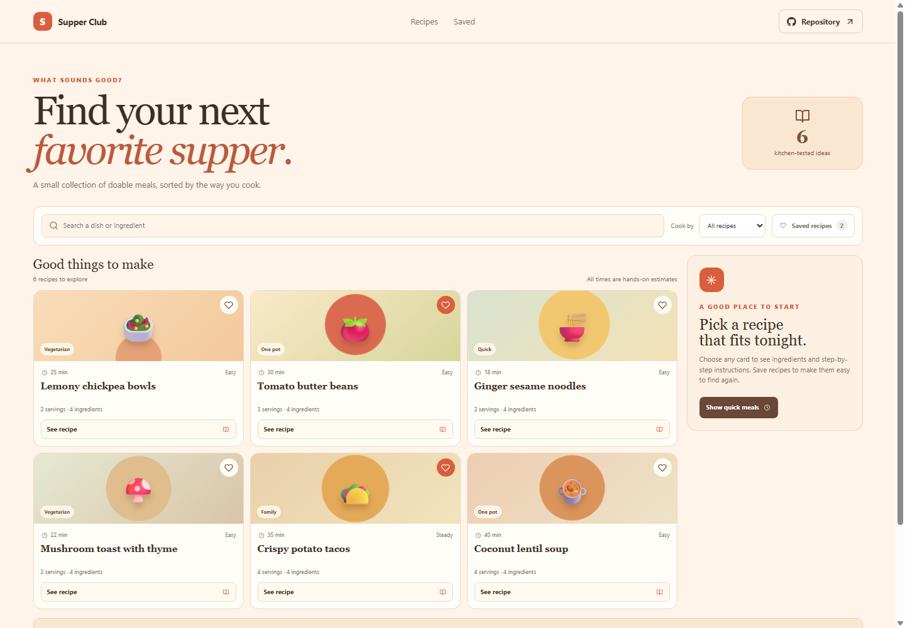

# Supper Club: Recipe Discovery

Supper Club is a compact collection of weeknight recipes. Browse by meal style or ingredient, open a recipe for clear steps, and save favorites for another day.

**GitHub Pages URL:** https://a2rp.github.io/recipe-discovery-app/ (available after deployment)

## Included

- Search recipe names, categories, and ingredient lists.
- Filter recipes by category and see prep time and serving count.
- Save and revisit favorite recipes.
- Open a recipe card to read its ingredients and cooking steps.
- Send a recipe ingredient list to the Market Day grocery list on the same browser.

## How to use it

Search for a dish or ingredient, then open a card to view instructions. Use the heart to save a recipe. Add ingredients to the grocery list to place them in the Market Day browser-saved list.

## Data and limits

The recipe collection is bundled with the app and does not require an API. Favorites use localStorage. The grocery-list action writes ingredient entries to the Market Day localStorage key in the same browser.

This is a browser-only utility. Clearing the browser’s site data removes its saved information.

## Run locally

~~~sh
npm install
npm run dev
~~~

## Checks and deployment

~~~sh
npm run lint
npm run build
npm run deploy
~~~

The deploy command builds the project and publishes the dist directory to the gh-pages branch. It requires the project’s public GitHub repository to be configured as origin.

## Future improvements

Ideas only. These are not implemented yet:

- Add dietary and allergen filters.
- Let people add and edit their own recipes.
- Include serving-size scaling and a weekly meal plan.

## Links

- Portfolio: [https://www.ashishranjan.net](https://www.ashishranjan.net)
- GitHub: [https://github.com/a2rp](https://github.com/a2rp)
- CodePen: [https://codepen.io/ash1198](https://codepen.io/ash1198)
- LinkedIn: [https://www.linkedin.com/in/aashishranjan](https://www.linkedin.com/in/aashishranjan)
- Facebook: [https://www.facebook.com/theash.ashish/](https://www.facebook.com/theash.ashish/)
- YouTube: [https://www.youtube.com/@ashishranjan-ashz?sub_confirmation=1](https://www.youtube.com/@ashishranjan-ashz?sub_confirmation=1)
- Email: [mailto:ash.ranjan09@gmail.com](mailto:ash.ranjan09@gmail.com)

## Support

- Support: [https://a2rp-donation-page.netlify.app/](https://a2rp-donation-page.netlify.app/)
- Buy Me a Coffee: [https://buymeacoffee.com/ashishranjan](https://buymeacoffee.com/ashishranjan)
- Patreon: [https://www.patreon.com/ashishranjan](https://www.patreon.com/ashishranjan)